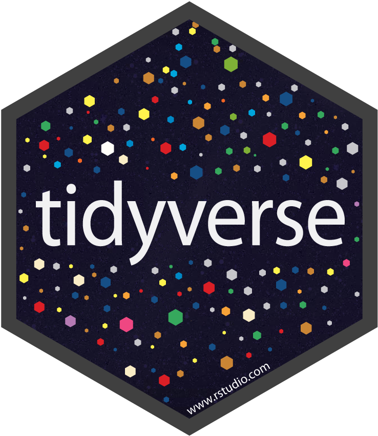
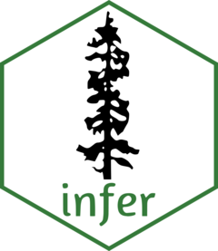

[ course website](https://atheobold.github.io/stat-313-website/){.btn target="_blank"} [ course catalog](https://catalog.calpoly.edu/search/?P=stat+331){.btn target="_blank"}

<br>

# Course description

These materials accompany the 4-unit, 2-day, second course in statistics, [STAT 313 - Applied Experimental Design and Regression Models](https://atheobold.github.io/stat-313-website/), offered through the [Minor in Statistics](https://statistics.calpoly.edu/content/minors).

In this course, students learn how to prepare data for analysis using the [`{tidyverse}`](https://www.tidyverse.org/) set of R package. Specifically, students build proficiency with the `{dplyr}` and `{ggplot2}` packages. Students then use the [`{infer}`](https://infer.netlify.app/) package to fit various regression and ANOVA models, using both simulation-based and theoretical methods. Throughout the course, students use Quarto to create professional-looking statistical reports.

<br>

:::::::: columns
::: {.column width="30%"}
```{r}
#| eval: true
#| echo: false
#| fig-align: "center"
#| out-width: "75%"
#| fig-alt: "the hex sticker for the tidyverse package in R, the sticker has multi-colored hexagons surrounding the tidyverse text in the center"

```
:::

::: {.column width="3%"}
:::

::: {.column width="30%"}
```{r}
#| eval: true
#| echo: false
#| fig-align: "center"
#| out-width: "75%"
#| fig-alt: "the hex sticker for the quarto software, the sticker is blue and says quarto with a small stop sign like symbol to the left of the text"

```
:::

::: {.column width="3%"}
:::

::: {.column width="30%"}
```{r}
#| eval: true
#| echo: false
#| fig-align: "center"
#| out-width: "75%"
#| fig-alt: "the hex sticker for the infer package in R, the sticker has a tall forested black tree above the package name"

```
:::
::::::::

# When is this taught?

At Cal Poly, this course is taught every quarter. I expect to teach this course at some point in the academic year, so the materials should be updated at least once annually.
