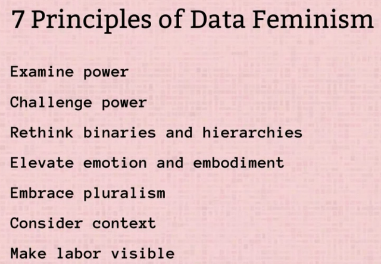

{fig-alt="A list of the 7 principles of data feminism---examine power, challenge power, rethink binaries and hierarchies, elevate emotion and embodiment, embrace pluralism, consider context, make labor visible."}

[ course website](https://atheobold.github.io/data-feminism/){.btn target="_blank"} 
 

# Course description

Data Feminism is a course that explores relationships among data, power, and justice through feminist theory. Throughout our time together we will examine how oppression shapes data practices and learn feminist strategies for recognizing bias, critiquing inequities, and designing ethical, justice-oriented approaches to data collection and analysis.

 

# When is this taught?

This course was taught in the spring of 2026 as a 2-unit (1-day a week) topics
course. I would like to see the ideas presented in the course developed into 
a larger course on data ethnography and qualitative methods. 

